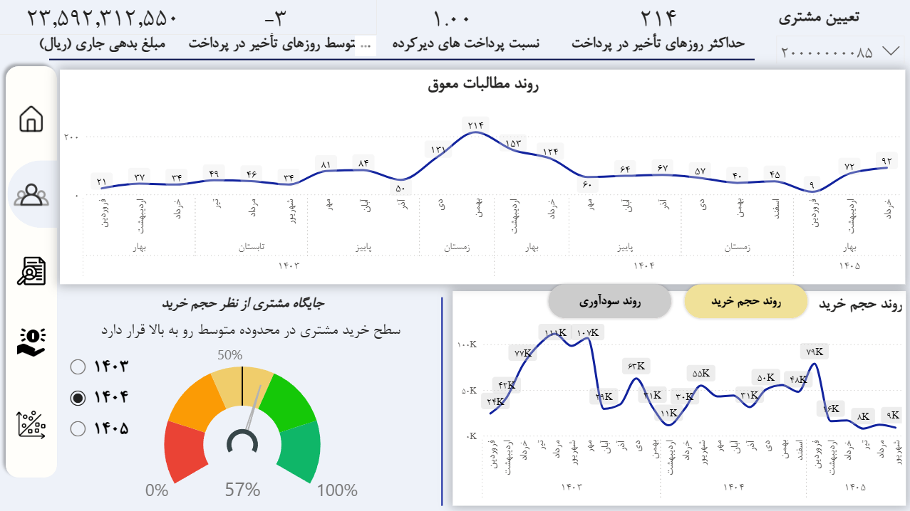
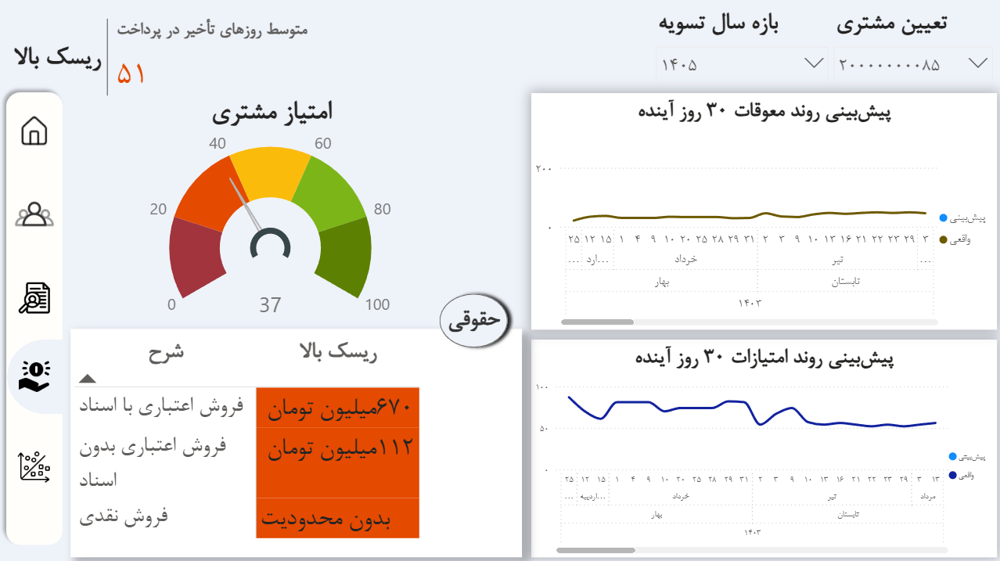

# PowerBI Customer Credit Risk Dashboard

## Project Overview

This project was developed to assess customer credit risk based on overdue payments.

The dashboard provides insights into customer payment behavior, outstanding receivables, payment delays, customer scoring, and credit risk classification. Its primary objective is to transform payment transaction data into actionable insights for customer evaluation and receivables monitoring.

## Business Challenge and Problem Solving

One of the main challenges of this project was **allocating customer payments to their corresponding transactions and identifying overdue amounts at the individual invoice level**.

Despite having no prior background in finance or accounting, I analyzed the payment data and developed an approach to allocate customer payments and identify overdue invoices individually. This made it possible to extract overdue receivables on an invoice-by-invoice basis rather than limiting the analysis to aggregated customer-level figures.

## Customer Credit Risk Classification Model

In this project, customers are classified according to the number of days their payments are overdue relative to their committed due dates. A base score is assigned to each risk category.

| Risk Category | Payment Delay | Base Score |
|---|---|---:|
| Very Low Risk | Up to 12 days | 100 |
| Low Risk | 13–20 days | 80 |
| Medium Risk | 21–40 days | 60 |
| High Risk | 41–60 days | 40 |
| Very High Risk | 61–90 days | 20 |

This rule-based framework provides a structured basis for comparing customer payment performance and supporting credit risk assessment.

## Dashboard Features

- **Payment Allocation and Overdue Analysis:** Examination of allocated payments and overdue invoices at the transaction level.
- **Customer Payment Behavior Analysis:** Visualization of payment delays and changes in overdue receivables over time.
- **Customer Scoring:** Presentation of customer scores based on the defined risk assessment framework.
- **Risk Classification:** Categorization of customers according to payment delay intervals.

## Dashboard Screenshots

### 1. Customer Payment Behavior and Receivables Trends

### 2. Customer Credit Risk Assessment and Trend Analysis

## Tools and Technologies

- Microsoft Power BI
- Data Modeling and Transformation
- DAX Measures and Key Performance Indicators (KPIs)
- Interactive Data Visualization
- Customer Payment Analysis
- Rule-Based Credit Risk Scoring
- VBA (Visual Basic for Applications)

## Project Scope

This repository includes selected dashboard screenshots to demonstrate the analytical approach, business problem-solving capabilities, and data visualization skills applied in this project. The complete Power BI report and underlying business data are not included in this repository.

## Confidentiality Considerations

The screenshots are shared for portfolio and demonstration purposes only. Confidential company and customer information must be removed or anonymized before public distribution.
